# Claude Projects

Work on all your projects with Claude Code from one VS Code window: no more one window per project and alt-tabbing to find the session that is waiting for you.

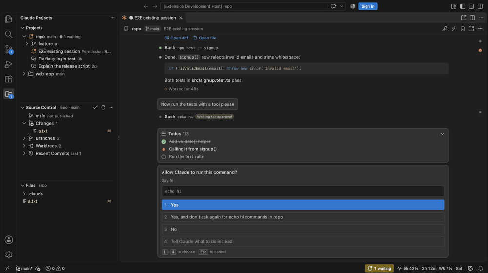

## What you get

**Sessions dashboard** (`pulse` button in the Projects view, or click the usage item in the status bar): every running Claude session across all projects — the ones here, in terminals, in other VS Code windows and in the Claude app — with the ones waiting for you at the top. Permission prompts can be answered right from the dashboard.

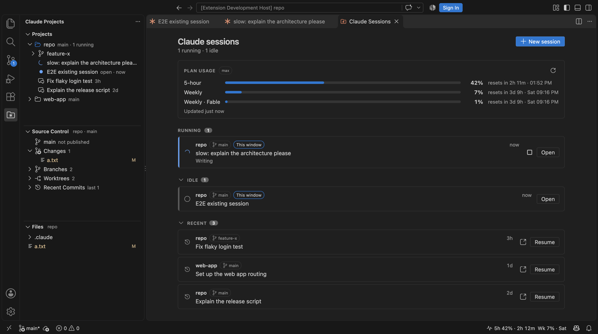

**Projects view** (the folder-with-asterisk icon in the activity bar)
- Your projects, saved by path only (folders are never moved or copied). Add them with **+** or import every folder you have used Claude Code in (`…` → *Import Projects from Claude History*).
- Under each project: its git worktrees and its Claude sessions, newest first. Sessions that need you are pinned to the top with an orange bell, running ones spin, finished-but-unread ones get a green check.
- Clicking a project or worktree switches the **Source Control** and **Files** views to it. Clicking a session opens it.

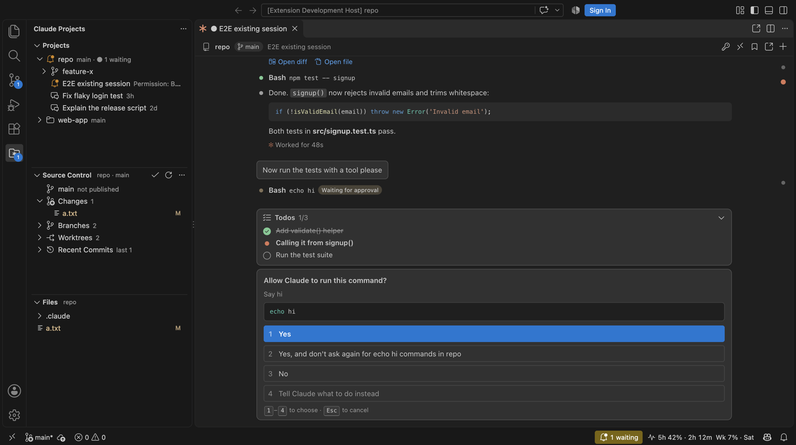

**Source Control view**: current branch (ahead/behind), staged and unstaged changes, branches, worktrees and recent commits for the selected project only. Clicking a changed file opens VS Code's normal diff. Stage, unstage, discard, commit, checkout, create branches and worktrees, pull, push and fetch from the view and its `…` menu.

**Files view**: the selected project's files and folders (respects `files.exclude`, dims git-ignored files, shows git status). Right-click a folder → *Open in New Window*.

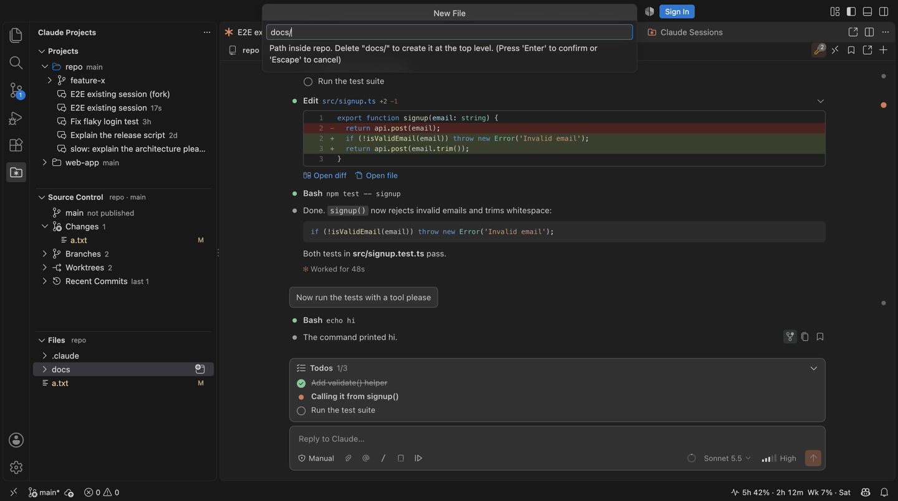

**Sessions**

Click a session to open it in a chat tab here (**Open Here**). It runs through the `claude` CLI on your machine with your own login and works like the official Claude Code extension. On top of that, it adds:

- **Fork from any reply**: hover one of Claude's replies and click the fork icon. You get a new chat with the conversation up to that point, and the original stays as it was. Forks show up in Projects right away and keep their own name.

  | The fork, copy and bookmark buttons on a reply | The fork, cut at that reply |
  |---|---|
  | 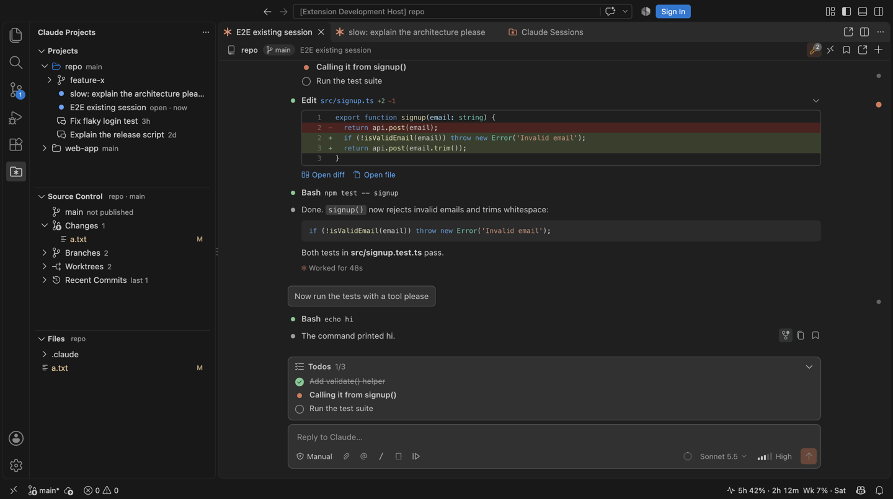 | 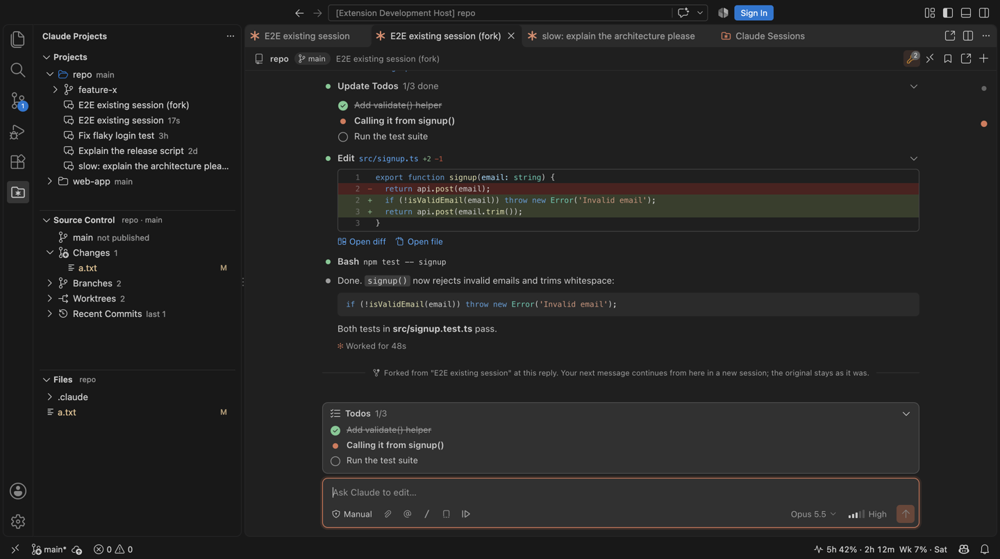 |

- **Shared .env**: keep API keys in one `.env` file (`claudeProjects.chat.globalEnvFile`, edit it with *Open Shared .env for Chats*). The key button in the chat header chooses which variables each chat gets. Claude can use them in commands (`$STRIPE_SECRET_KEY`), but it only knows their names, so the values never show in the chat.

  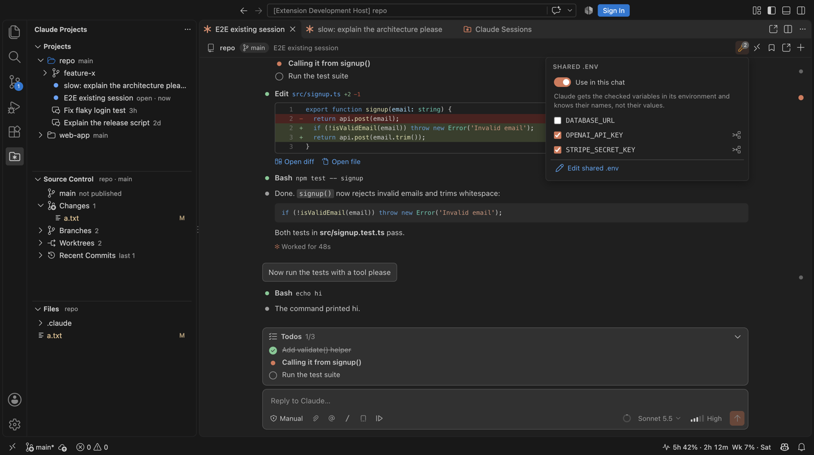

- **Continue when limits reset**: when a chat stops at your plan's usage limit, turn on *Continue automatically when limits reset*. About a minute after the reset, the chat sends `continue` for you. To have it on for every new chat, set `claudeProjects.chat.autoContinueAfterLimit`.

  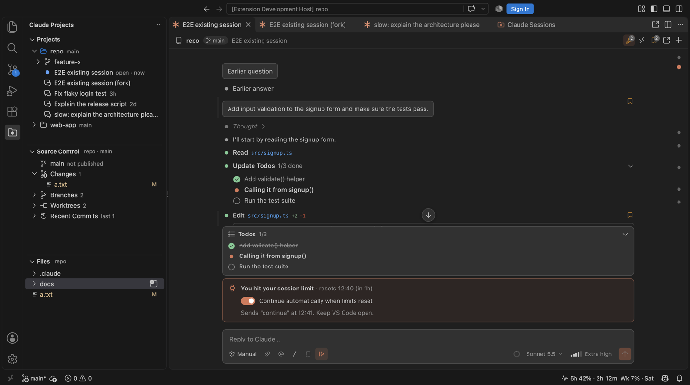

- **Prompt presets**: a button in the message box inserts prompts you use often, like "create a worktree, commit as you go, don't push", in front of what you type. Set your own in `claudeProjects.chat.promptPresets`.

  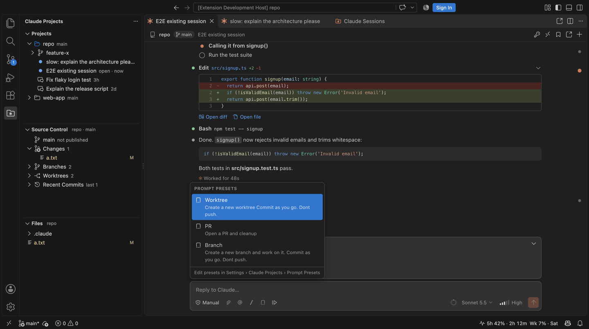

- **Bookmarks**: bookmark any message (yours, Claude's, or a tool call). The bookmark button in the chat header lists them and jumps back. *Go to Bookmarked Message…* searches bookmarks across all sessions.

  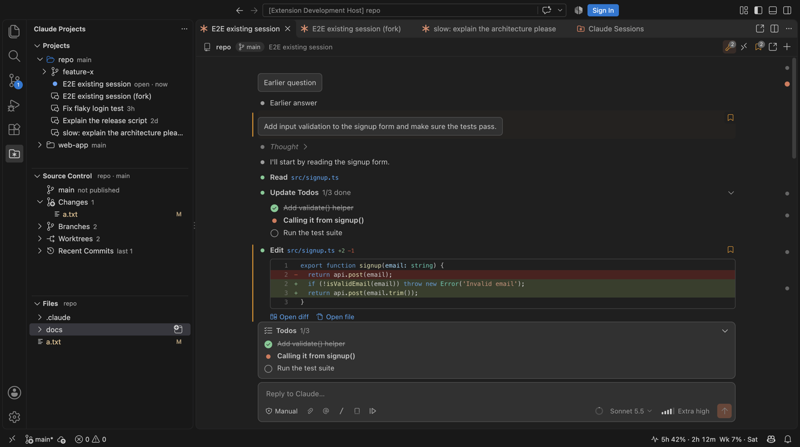

- **Yolo auto mode** (band-aid icon in the mode picker): auto mode, and when Claude still asks for permission, the extension answers yes for you. Questions and plan reviews still wait for you, and each approval leaves a line in the chat. Hide it with `claudeProjects.chat.showYoloAutoMode`.
- **Header shortcuts**: click the project name at the top of a chat to show its project (or worktree) in the Projects view. Click the session name to rename it right there (Enter saves, Esc cancels).
- **Icon-only tabs**: turn on `claudeProjects.chat.iconOnlyTabs` to show chat tabs as just their icon, to fit more of them. A dot still marks a chat that is waiting for you.
- **Remote Control**: a header button lets you continue the chat from claude.ai or the Claude app.
- **Finding your way in long chats**: dots along the chat's right edge jump to each of your messages. A badge shows how many agents are running, and each reply lists the skills and agents it used.
- **Copying**: a copy button on each reply (as Markdown), plus Cmd+C, Cmd+X and right-click for any part of the chat.
- **MCP input**: when an MCP server asks for something mid-session (a form or a sign-in link), a card shows it and sends your answer to the server, not to Claude.

  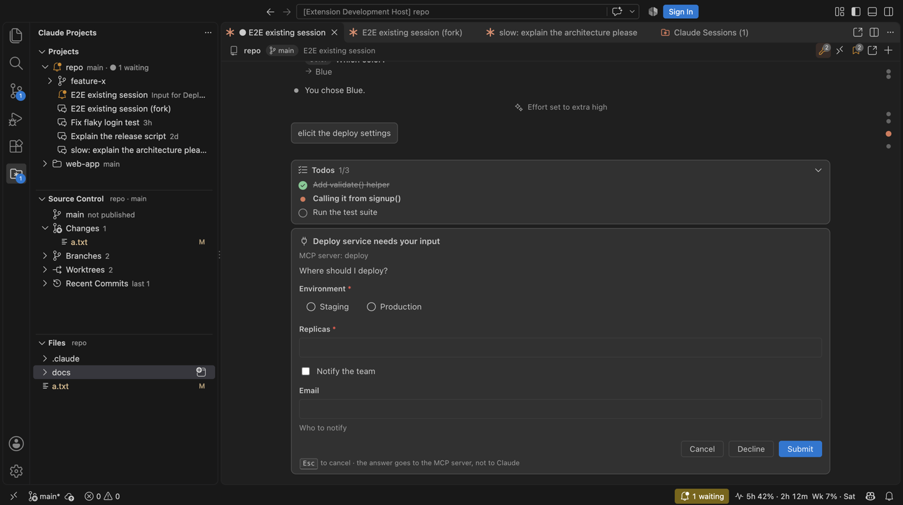

- **Names that stick**: renamed and forked chats keep their names, in the tab and after a restart.
- **Open in Claude Extension**: opens the session in its own window, in the official Claude Code extension. This button is also in the chat tab's title bar. To make it what clicking a session does, set `claudeProjects.sessions.defaultOpenMode`.

**Attention**: a badge on the activity bar icon, a "waiting" item in the status bar (click it to jump to the next session that needs you), a dot in the chat tab title, and a system notification when a session needs you while VS Code is in the background. On Windows it is a toast, and clicking it opens the session. On macOS, clicking opens the session if [terminal-notifier](https://github.com/julienXX/terminal-notifier) is installed (`brew install terminal-notifier`).

**Usage bar**: your plan's 5-hour and weekly usage with reset times in the status bar (hover for details, including per-model weekly limits). The numbers come from Claude Code itself (the same as `/usage`); the extension never reads your credentials.

## Install

```bash
npm install
npm run package
code --install-extension dist-vsix/claude-projects.vsix
```

Then reload VS Code. The extension finds `claude` automatically (`~/.local/bin/claude`, your shell `PATH`, Homebrew, or the copy bundled with the official extension); set `claudeProjects.claudePath` if it doesn't.

### Windows

Works on macOS and Windows. On Windows the extension finds `claude.exe` from the native installer (`%USERPROFILE%\.local\bin`), npm's `claude.cmd` (`%APPDATA%\npm`), bun, scoop, winget, or the official extension's copy, plus anything on `PATH`. Claude Code itself needs [Git for Windows](https://git-scm.com/download/win) there, and so do this extension's Source Control and Files views.

Windows differences:
- Notifications are Windows toasts, shown through Windows PowerShell. If a toast can't be shown, you get VS Code's own notification instead.
- Menus say *Reveal in File Explorer* instead of *Reveal in Finder*.
- Stopping a session ends Claude's whole process tree (`taskkill /T`), because Windows has no signals.
- The check that drops stale entries from Claude's live-session list (a pid reused by another program) is skipped, because it relies on `ps`.

## Settings

| Setting | Default | |
|---|---|---|
| `claudeProjects.sessions.defaultOpenMode` | `here` | What clicking a session does (`here` or `claudeExtension`). |
| `claudeProjects.sessions.maxPerProject` | `8` | Sessions listed per project/worktree before "Show more". |
| `claudeProjects.sessions.idleProcessTimeoutMinutes` | `30` | Stop an idle Claude process whose tab is closed (it resumes on your next message). |
| `claudeProjects.chat.defaultPermissionMode` | `default` | Mode for new sessions here. |
| `claudeProjects.chat.defaultModel` | — | Model for new sessions here (empty = your Claude Code default). |
| `claudeProjects.chat.defaultEffort` | — | Effort for new sessions here (empty = the model default). |
| `claudeProjects.chat.promptPresets` | a few | Prompts in the presets menu of the message box. |
| `claudeProjects.chat.autoContinueAfterLimit` | `false` | Start new chats with *Continue automatically when limits reset* on. |
| `claudeProjects.chat.globalEnvFile` | `~/.claude-projects/.env` | The shared `.env` file for chats. |
| `claudeProjects.chat.allowBypassPermissions` | `false` | Offer "Bypass permissions" in the mode picker. |
| `claudeProjects.chat.iconOnlyTabs` | `false` | Show chat tabs as just their icon, without the session name. |
| `claudeProjects.chat.showYoloAutoMode` | `true` | Offer "Yolo auto" in the mode picker (turn off to hide it). |
| `claudeProjects.chat.showThinking` | `true` | Show Claude's thinking summaries. |
| `claudeProjects.followActiveSession` | `true` | Switching chat tabs switches Source Control and Files to that session's project. |
| `claudeProjects.notifications.*` | on | System notifications on macOS and Windows (only while VS Code is in the background, sound, turn-complete, sessions outside this window, in-app toasts). |
| `claudeProjects.dashboard.showAllProjects` | `true` | Also show sessions from folders that are not in your project list. |
| `claudeProjects.usage.refreshIntervalMinutes` | `5` | How often usage refreshes (running sessions also update it live). |

Tip: bind *Claude Projects: Go to Next Session Needing Input* to a key for a one-keystroke "what needs me?".

## How it works

- Session lists come from Claude Code's transcripts in `~/.claude/projects/` (titles match Claude Code's own: your `/rename`, then the AI title, then the last prompt).
- Sessions running anywhere on the machine are read from Claude Code's live registry (`~/.claude/sessions/<pid>.json`), which says whether each one is busy, idle or waiting for a permission/answer.
- "Open Here" drives `claude -p --input-format stream-json --output-format stream-json --permission-prompt-tool=stdio`, the same protocol the official extension and the Agent SDK use, so sessions stay fully compatible: you can continue any of them in the terminal or the official extension later.

## Development

```bash
npm run build        # bundle extension + webviews into dist/
npm run watch
npm run typecheck
npm test             # unit tests (uses a fake claude CLI)
node test/e2e/run.mjs                    # end-to-end in a throwaway VS Code profile
node test/e2e/run.mjs --with-official    # … plus the hand-off to the official extension
CLAUDE_INTEGRATION=1 npx vitest run --config vitest.integration.mts   # a few cheap Haiku turns with the real CLI
```

On Windows, `node test/e2e/run.mjs` downloads a copy of VS Code for the test unless `VSCODE_PATH` points at one.

The chat UI can be developed in a browser: serve the repo (`python3 -m http.server 47391`) and open `http://127.0.0.1:47391/test/webview/chat-harness.html?fixture=conversation&theme=dark`.

## License

MIT. See `LICENSE.md`.
